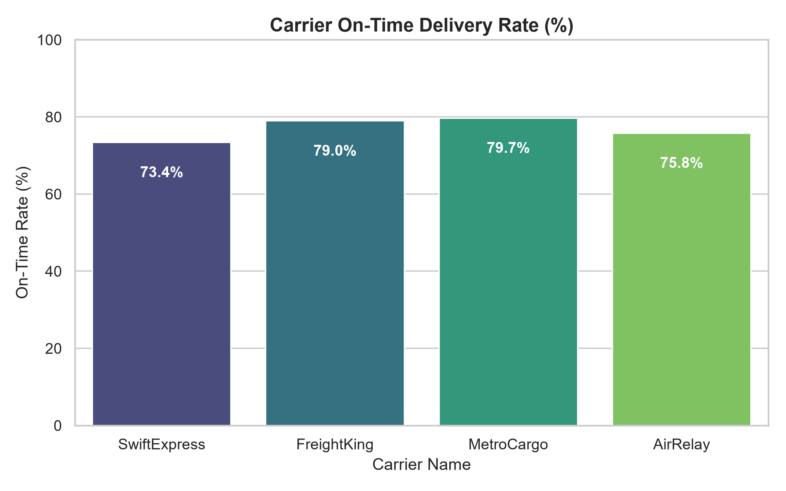
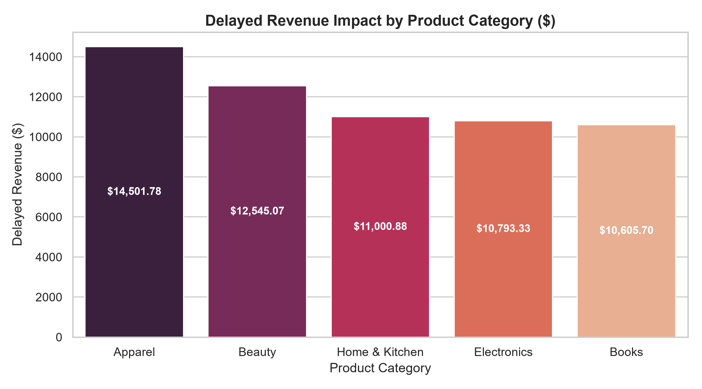

# Delivery Delay & Supply Chain Operations Analytics

## 📌 Project Overview
This project models and analyzes supply chain delivery delays for a simulated e-commerce enterprise. Using a relational MySQL database and Python, it identifies operational bottlenecks across carriers, warehouses, and product categories to quantify revenue at risk due to late shipments.

---

## 🏗️ Relational Schema Design
The database uses a 4-table relational schema designed in MySQL:
- **`orders`**: Stores transaction timestamps, promised delivery dates, customer IDs, and order values.
- **`shipments`**: Tracks dispatch times, assigned carriers, regional warehouses, and actual delivery dates.
- **`warehouses`**: Tracks regional fulfillment facilities and daily processing capacities.
- **`carriers`**: Contains delivery logistics partners and associated service tiers.

---

## 📊 Key Operational Insights & Findings
1. **Overall Delay Rate**: ~25% of all orders experienced fulfillment or transit delays beyond the promised delivery date.
2. **Carrier Performance**: Identified significant variance in on-time delivery percentages between ground and express carriers.
3. **Revenue Impact**: High-value product categories represented the highest concentration of revenue at risk from delivery lags.

---

## 🛠️ Visualizations
*(Generated via Pandas, Seaborn & Matplotlib)*

### Carrier On-Time Delivery Rates


### Delayed Revenue Impact by Category


---

## 🚀 How to Run Locally

### Prerequisites
- Python 3.x
- MySQL Server & MySQL Workbench

### Setup
1. **Clone the repository**:
   ```bash
   git clone [https://github.com/YOUR_USERNAME/delivery-delay-analytics.git](https://github.com/YOUR_USERNAME/delivery-delay-analytics.git)
   cd delivery-delay-analytics